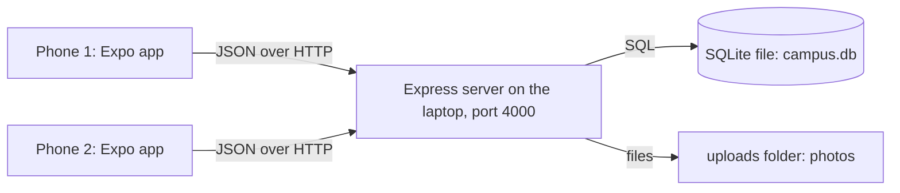

# How Campus Fix works

This is the explanation I give the judges. It is written the way I would say it.

## The big picture

There are three parts.

1. **The app** (`app/`) is what the student holds. It never touches the database. It only sends requests to the server and shows what comes back.
2. **The server** (`server/`) is the only thing allowed to read or change data. It checks who is asking, checks the input, and runs the SQL.
3. **The database** is one SQLite file, `server/campus.db`. Photos are saved as files in `server/uploads/`, and the database stores only the path.

I used a server instead of storing data on the phone because the task needs students to see each other's reports. Two emulators can only share data if it lives in one place they both reach.

## The database tables

| Table | What one row means |
|---|---|
| `users` | One account. Has a bcrypt password hash and a role: `student` or `admin` |
| `categories` | One kind of problem, with an icon name |
| `issues` | One report: who, category, title, description, building, room, impact, photo path, status |
| `upvotes` | "This user upvoted this issue". The primary key is `(user_id, issue_id)` |
| `status_history` | One status change: from, to, who did it, an optional note, when |
| `point_events` | One line in the points ledger: user, amount (can be negative), reason |
| `user_badges` | "This user earned this badge". The primary key is `(user_id, badge_code)` |

### Rules the database enforces by itself

These hold even if the app or the API had a bug.

- **One upvote per student per report.** The primary key on `upvotes` is the pair `(user_id, issue_id)`. A second row with the same pair is refused by SQLite.
- **Only four statuses exist.** `issues.status` has a `CHECK` that allows only Reported, Acknowledged, In Progress and Resolved.
- **No orphan rows.** Foreign keys mean an upvote cannot point at a report that does not exist.
- **A badge is earned once.** Same idea as upvotes: the primary key is `(user_id, badge_code)`.

### Two things I do not store

- **The upvote count.** It is always `COUNT(*)` from the `upvotes` table. A stored number could drift out of step with the real votes; a count cannot.
- **The points total.** It is always `SUM(amount)` from `point_events`. Taking points back is a new negative row, so the full history stays visible and nothing is ever edited.

## What happens when a student taps upvote

1. `UpvoteButton.tsx` changes the number on screen straight away, so it feels instant.
2. It calls `api()` in `app/src/api.ts`, which sends `POST /issues/23/upvote` with the login token in the `Authorization` header.
3. On the server, `requireAuth` in `middleware/auth.js` checks the token and loads the user.
4. `addUpvote` in `routes/issues.js` runs inside one transaction. It checks the report exists, that it is not the student's own report, and that it is not already resolved or already upvoted.
5. It inserts the upvote row, then adds two ledger rows: +1 for the voter and +2 for the reporter. Then it checks whether either student has earned a badge.
6. If anything fails, the transaction rolls back and nothing is saved.
7. The server sends back the updated report. If it sent an error instead, the button puts the old number back and shows the message.

## How login and permissions work

- **Passwords** are hashed with bcrypt before they are saved. The plain password is never stored and never sent back.
- **Logging in** returns a JWT. That is a signed token saying "user 5, role student", valid for 7 days. The app keeps it in the phone's secure storage and sends it with every request.
- **`requireAuth`** rejects requests without a valid token (401). It also re-reads the user from the database, so a deleted account stops working at once.
- **`requireAdmin`** rejects anyone whose role is not admin (403). All `/admin` routes go through it. Hiding the Manage tab in the app is only for looks; the server is what actually blocks students.
- **Input checks.** Every request body is checked with zod in `validation.js` before the database sees it. Bad input gets a 400 with a readable message.
- **SQL injection.** Every value from the user goes into SQL through `?` placeholders, never by joining strings.

## How status changes work

The order lives in one place, `NEXT_STATUS` in `server/src/config.js`. `PATCH /admin/issues/:id/status` accepts only the next status in that order, so an admin cannot skip a step or go backwards. The update includes `WHERE status = <the old status>`, so if two admins press the button at the same moment, only the first one changes anything.

Each change writes a `status_history` row. That table is what the timeline on the report screen shows.

Students never choose who fixes a problem. The report form has no such field, and the server has no such column.

## How the gamification works

All the rules are in `server/src/gamification.js`.

| Event | Points |
|---|---|
| Submit a report | +5 |
| An admin acknowledges it | +15 |
| It gets resolved | +25 |
| Another student upvotes it | +2 |
| You upvote someone else's report | +1 |

The idea is to reward useful reports, not many reports. 40 of the 45 points a report can earn arrive only after an admin confirms it is real, so spam earns almost nothing. Withdrawing an upvote takes the points back, so voting and un-voting cannot be used to farm points.

- **Levels** come from the points total: Newcomer, Spotter (50), Fixer (150), Campus Guardian (300), Legend (600).
- **Badges** are checked from real counts in the database after every action.
- **The leaderboard** ranks students by points, for this week or all time.
- **The campus goal** counts fixes in the last 30 days against a shared target of 20.
- **Duplicate detection** shows open reports for the same building and category before a student submits, and offers an upvote instead.

### How a reward appears on another phone

The app re-reads the profile every 10 seconds (`app/src/session.tsx`). It remembers the newest ledger row it has already shown. If newer rows exist, it shows a banner such as "+15 points, your report was acknowledged". That is why Alice sees her reward a few seconds after the admin acts on a different emulator. The feed and the report screen refresh on the same 10-second timer.

## How the app is organised

| Path | Job |
|---|---|
| `app/app/` | The screens. Each file is a route (Expo Router) |
| `app/app/(auth)/` | Login and register |
| `app/app/(tabs)/` | Issues feed, Report, Leaderboard, Profile, and Manage for admins |
| `app/app/issue/[id].tsx` | One report in full |
| `app/src/api.ts` | The only file that talks to the server |
| `app/src/auth.tsx` | Who is logged in |
| `app/src/session.tsx` | Profile data and the reward banners |
| `app/src/theme.ts` | Every colour, font and spacing value, for light and dark mode |
| `app/src/components/` | Reusable pieces: issue card, status chip, timeline, upvote button |

## How I know it works

- `npm run smoke` runs 71 checks against the real API, including the database refusing a duplicate upvote and data surviving a restart.
- The app was walked through as two students and an admin on three screens at once, covering report with photo, live update, upvote, duplicate warning, all four status steps, rewards and level-up.
- `docs/TEST_MATRIX.md` is the checklist for the two Android emulators.
