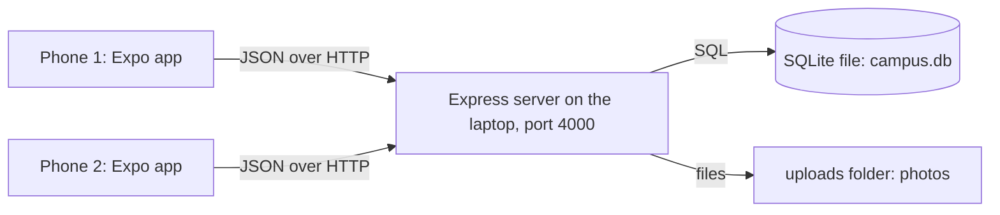

# How Campus Fix works

This is the explanation I give the judges. It is written the way I would say it.

## The big picture

There are three parts.

1. **The app** (`app/`) is what the student holds. It never touches the database. It only sends requests to the server and shows what comes back.
2. **The server** (`server/`) is the only thing allowed to read or change data. It checks who is asking, checks the input, and runs the SQL.
3. **The database** is one SQLite file, `server/campus.db`. Photos are saved as files in `server/uploads/`, and the database stores only the path.

I used a server instead of storing data on the phone because the task needs students to see each other's reports. Two emulators can only share data if it lives in one place they both reach.

## The database tables

| Table | What one row means |
|---|---|
| `users` | One account. Has a bcrypt password hash and a role: `student` or `admin` |
| `departments` | One team that fixes problems: IT Services, Estates & Maintenance, Cleaning Services, Health & Safety, Student Services |
| `categories` | One kind of problem, with an icon name and the department that fixes it (`department_id`) |
| `issues` | One report: who, category, title, description, building, room, impact, photo path, status |
| `upvotes` | "This user upvoted this issue". The primary key is `(user_id, issue_id)` |
| `status_history` | One status change: from, to, who did it, an optional note, an optional photo of the fix, when |
| `comments` | One comment on a report: who wrote it, the text (1 to 500 characters), when |
| `point_events` | One line in the points ledger: user, amount (can be negative), reason |
| `user_badges` | "This user earned this badge". The primary key is `(user_id, badge_code)` |

### Rules the database enforces by itself

These hold even if the app or the API had a bug.

- **One upvote per student per report.** The primary key on `upvotes` is the pair `(user_id, issue_id)`. A second row with the same pair is refused by SQLite.
- **Only four statuses exist.** `issues.status` has a `CHECK` that allows only Reported, Acknowledged, In Progress and Resolved.
- **No orphan rows.** Foreign keys mean an upvote cannot point at a report that does not exist.
- **A badge is earned once.** Same idea as upvotes: the primary key is `(user_id, badge_code)`.
- **Students cannot assign responsibility.** The department comes from the category through `categories.department_id`. The API never reads a department from a student, so even a forged request cannot pick who fixes a problem.

### Two things I do not store

- **The upvote count.** It is always `COUNT(*)` from the `upvotes` table. A stored number could drift out of step with the real votes; a count cannot.
- **The points total.** It is always `SUM(amount)` from `point_events`. Taking points back is a new negative row, so the full history stays visible and nothing is ever edited.

## What happens when a student taps upvote

1. `UpvoteButton.tsx` changes the number on screen straight away, so it feels instant.
2. It calls `api()` in `app/src/api.ts`, which sends `POST /issues/23/upvote` with the login token in the `Authorization` header.
3. On the server, `requireAuth` in `middleware/auth.js` checks the token and loads the user.
4. `addUpvote` in `routes/issues.js` runs inside one transaction. It checks the report exists, that it is not the student's own report, and that it is not already resolved or already upvoted.
5. It inserts the upvote row, then adds two ledger rows: +1 for the voter and +2 for the reporter. Then it checks whether either student has earned a badge.
6. If anything fails, the transaction rolls back and nothing is saved.
7. The server sends back the updated report. If it sent an error instead, the button puts the old number back and shows the message.

## How login and permissions work

- **Passwords** are hashed with bcrypt before they are saved. The plain password is never stored and never sent back.
- **Logging in** returns a JWT. That is a signed token saying "user 5, role student", valid for 7 days. The app keeps it in the phone's secure storage and sends it with every request.
- **`requireAuth`** rejects requests without a valid token (401). It also re-reads the user from the database, so a deleted account stops working at once.
- **`requireAdmin`** rejects anyone whose role is not admin (403). All `/admin` routes go through it. Hiding the Manage tab in the app is only for looks; the server is what actually blocks students.
- **Input checks.** Every request body is checked with zod in `validation.js` before the database sees it. Bad input gets a 400 with a readable message.
- **SQL injection.** Every value from the user goes into SQL through `?` placeholders, never by joining strings.

## How status changes work

The order lives in one place, `NEXT_STATUS` in `server/src/config.js`. `PATCH /admin/issues/:id/status` accepts only the next status in that order, so an admin cannot skip a step or go backwards. The update includes `WHERE status = <the old status>`, so if two admins press the button at the same moment, only the first one changes anything.

Each change writes a `status_history` row. That table is what the timeline on the report screen shows.

Students never choose who fixes a problem. The report form has no such field, and the server has no such column.

## Campus map and navigation

- **The map** is vector shapes traced from the official MCAST Paola campus map: 17 blocks, the unlabelled building, gates, parking, lawns and the campus boundary. The data lives in `app/src/campus.json`, in the original image's pixel coordinates, and is drawn with `react-native-svg` in `app/src/components/CampusMap.tsx`.
- **Routing.** Walkways are a graph of 46 points and 54 links that go around buildings (checked automatically: no link crosses a building outline). `findRoute` in `app/src/navigation.ts` runs Dijkstra's shortest-path algorithm from the start's door to the destination's door, then turns every bend over 35 degrees into a step ("Right at Block S, after 22 m").
- **Distances** use a scale of about 0.33 m per map pixel and a walking speed of 80 m per minute. They are estimates from the map's proportions, not surveyed measurements.
- **Linked to reports.** Block names are the same in reports and on the map, so the map shows a badge with the number of open problems on each block, "Report here" opens the form with that building chosen, and every report has "Show on map".
- **Gestures.** Drag to move, pinch or use + and − to zoom, 3D tilts the map with a perspective transform, and Re-centre returns to the Students' House.

## Live location, satellite view and emergency help

- **Where am I?** `app/src/location.ts` watches the phone's GPS with `expo-location` (best accuracy, an update every 2 m of movement). `toMap` turns latitude and longitude into map pixels: the map is drawn north-up, anchored on MCAST's published coordinate (35.8773 N, 14.5063 E) at 0.33 m per pixel. `locate` in `navigation.ts` then checks which building outline the point is inside (a point-in-polygon test), or which one is nearest.
- **Honest about accuracy.** Phone GPS is usually 5 to 15 m off, and the anchor is approximate. "Fix position" lets a student tap the building they are standing at; the app saves that offset on the phone and uses it from then on.
- **Live directions.** When a route starts from "Your location", the start is the GPS point, joined to the nearest walkway point whose straight line does not cross a building. Every time the position moves, the route is recalculated and the map follows you. Reaching the door, or stepping inside the destination building, shows "You have arrived".
- **Satellite.** The globe button swaps the drawn map for real satellite imagery. iPhone uses Apple's satellite map and Android in Expo Go uses Google's, both with the route, building markers and your blue dot (`SatelliteView.native.tsx`). The web version, and an installed Android app with no Google key, show Google's own free satellite embed (`satelliteUrl.ts`): it centres on the chosen block, on you while following, or on the campus, and shows Google's walking directions while a route is open. The weather animation is switched off in satellite so the photos stay clear.
- **Full names.** Zooming in shows every institute's full name, laid out by hand so no two labels overlap (checked by a script). Zoomed out, only the block codes show.
- **Emergency help** (`app/app/emergency.tsx`) follows the MCAST emergency poster: call 112, the MCAST nurse (Paola and Mosta) and security (Paola, Mosta, Gozo, Qormi), all one tap. It shows where you are on campus and can share that, with GPS and a map link, as a message. SOS buttons sit on the feed and on the map.

## Home, weather, departments, languages and the tour

- **Home is the first tab** for students and admins: live weather with the mascot, quick actions, SOS, the tour, campus progress and the latest reports. Admins also see open reports per department, each a shortcut into Manage.
- **Departments.** `GET /issues?department=<id>&building=<name>` filters in SQL (bound parameters; the building must be one of the known buildings). `GET /admin/stats` returns `byDepartment`. Manage groups the queue under one heading per department, with a tile per department to narrow it.
- **Live weather** (`app/src/weather.tsx`) comes from Open-Meteo, a free weather service with no key, for MCAST's coordinate, every 10 minutes. The WMO weather code becomes one of ten kinds (sunny, partly cloudy, cloudy, fog, drizzle, rain, thunderstorm, snow, windy, clear night); wind over 30 km/h makes it windy, and after sunset sunny becomes clear night. The season comes from the date. Offline, it falls back to the season. "Preview the weather" shows any weather or season for a demo.
- **Weather avatar** (`WeatherAvatar.tsx`): the mascot with a pose and props per weather (umbrella, sunglasses, beanie and scarf, lantern, nightcap, leaning into the wind) and per season (scarf in winter, leaf in autumn, flower in spring, sun hat in summer).
- **Weather effects** (`WeatherEffects.tsx`): animated rain, storm with lightning, drizzle, snow, sun rays, drifting clouds, fog, wind streaks and stars, plus falling leaves in autumn and petals in spring. Drawn over the Home card and the drawn map (not over satellite photos). They never take touches and stay still when the phone's "reduce motion" setting is on.
- **Languages** (`i18n.tsx`, `locales.ts`): English, Maltese, Italian, Spanish, French, German, Portuguese, Hindi, Chinese and Arabic, 159 phrases each (checked by a script: no missing phrase, no broken placeholder). The choice is saved on the phone. Reports and comments stay in the language they were written in.
- **Tour** (`app/app/tour.tsx`): 8 steps for students, 7 for admins. Each step has an animated finger tapping that feature's button and a "Try it" button that opens it. "Listen" reads each step aloud with `expo-speech`, choosing a male voice in the chosen language when the phone has one (otherwise the default voice at a lower pitch), and moves on by itself.

## Design

"Glass spheres in the dark": a wallpaper picture of large glass spheres on graphite, rim-lit in lavender and electric blue (`app/src/components/Wallpaper.tsx`, `assets/images/wallpaper.jpg`), breathing with a very slow zoom and drift. The map screen leaves it out so nothing shows through the map. All motion runs from one shared clock (`app/src/motion.ts`, `useForever`), so it never stops, never restarts and carries on in step when you change screen; hidden screens pause it to save battery, and "reduce motion" makes it a still picture. Panes on top are frosted glass (`expo-blur`) with a bright top edge (`Glass.tsx`); the main button is polished silver. Every control presses in and springs back, and vibrates through `expo-haptics` (`app/src/haptics.ts`): a light tick for choosing, a firmer tap for tabs and upvotes, a success pattern for rewards, a buzz for errors. Screens slide in from the right. Empty and loading screens show "Tag", an animated mascot (`app/src/components/Mascot.tsx`). Status colours stay faintly tinted (grey, blue, amber, green) so they can be told apart, and each status also has its own icon and label.

## Comments and the photo of the fix

- **Comments.** `POST /issues/:id/comments` adds a row to `comments`. Students and the admin can both comment; the app labels staff comments. Comments earn no points, so nobody can climb the leaderboard by posting "+1". The text length is checked twice: by zod in the API and by a CHECK constraint in the table.
- **Photo of the fix.** When the admin marks a report Resolved, the status change can be sent as a multipart form with a photo. It is stored like the student's photo, and its path goes on that `status_history` row. The server refuses a photo on any other step. The report screen shows the student's photo and the fix photo side by side.
- **Upgrading an existing database.** Databases created before this feature have no `photo_path` column. On start-up, `db.js` checks the columns with `PRAGMA table_info` and adds it with `ALTER TABLE` if it is missing, so no data is lost.

## How the gamification works

All the rules are in `server/src/gamification.js`.

| Event | Points |
|---|---|
| Submit a report | +5 |
| An admin acknowledges it | +15 |
| It gets resolved | +25 |
| Another student upvotes it | +2 |
| You upvote someone else's report | +1 |

The idea is to reward useful reports, not many reports. 40 of the 45 points a report can earn arrive only after an admin confirms it is real, so spam earns almost nothing. Withdrawing an upvote takes the points back, so voting and un-voting cannot be used to farm points.

- **Levels** come from the points total: Newcomer, Spotter (50), Fixer (150), Campus Guardian (300), Legend (600).
- **Badges** are checked from real counts in the database after every action.
- **The leaderboard** ranks students by points, for this week or all time.
- **The campus goal** counts fixes in the last 30 days against a shared target of 20.
- **Duplicate detection** shows open reports for the same building and category before a student submits, and offers an upvote instead.

### How a reward appears on another phone

The app re-reads the profile every 10 seconds (`app/src/session.tsx`). It remembers the newest ledger row it has already shown. If newer rows exist, it shows a banner such as "+15 points, your report was acknowledged". That is why Alice sees her reward a few seconds after the admin acts on a different emulator. The feed and the report screen refresh on the same 10-second timer.

## How the app is organised

| Path | Job |
|---|---|
| `app/app/` | The screens. Each file is a route (Expo Router) |
| `app/app/(auth)/` | Login and register |
| `app/app/(tabs)/` | Issues feed, Report, Leaderboard, Profile, and Manage for admins |
| `app/app/issue/[id].tsx` | One report in full |
| `app/src/api.ts` | The only file that talks to the server |
| `app/src/auth.tsx` | Who is logged in |
| `app/src/session.tsx` | Profile data and the reward banners |
| `app/src/theme.ts` | Every colour, font and spacing value, for light and dark mode |
| `app/src/components/` | Reusable pieces: issue card, status chip, timeline, upvote button |

## How I know it works

- `npm run smoke` runs 97 checks against the real API, including the database refusing a duplicate upvote and data surviving a restart.
- The app was walked through as two students and an admin on three screens at once, covering report with photo, live update, upvote, duplicate warning, all four status steps, rewards and level-up.
- `docs/TEST_MATRIX.md` is the checklist for the two Android emulators.

## Hosting

`server/src/app.js` builds the Express app (API, QR page, web app). `server/src/index.js` runs it on a port for the laptop; `api/index.js` exports it as a Vercel serverless function. `vercel.json` serves `app/dist` as static files and sends `/api/*`, `/uploads/*`, `/get`, `/qr.svg` and `/share-info` to the function. On Vercel, files can only be written to `/tmp`, so `DATA_DIR` points the database and uploads there (`server/src/config.js`).
